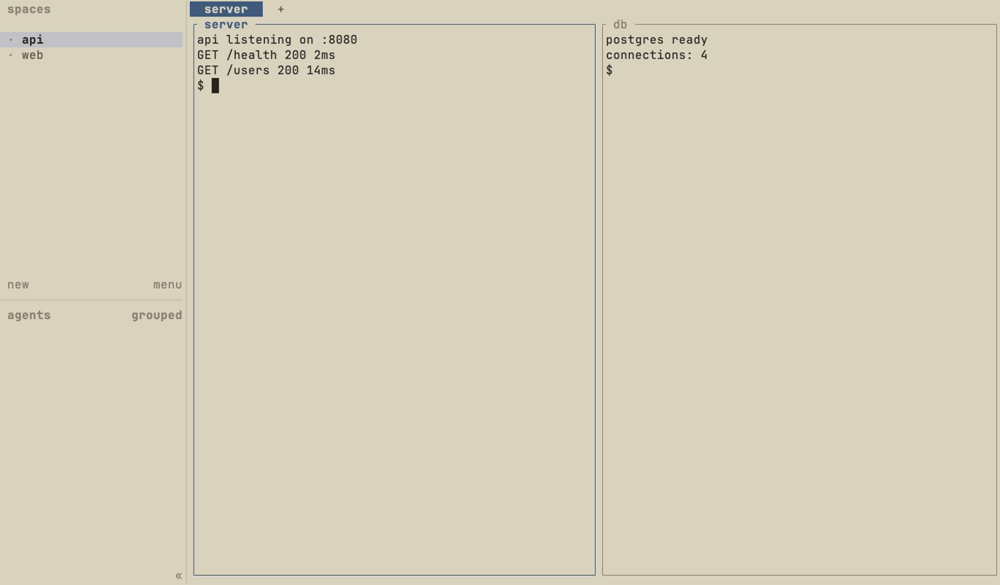

# herdr-pane-easy-move

Move a [herdr](https://herdr.dev) pane by pointing at a map.



Inspired by [herdr-pane-mover](https://github.com/osamahbeig/herdr-pane-mover) by osamahbeig, which this plugin reworks into a visual picker. See [Credits](#credits).

Text menus like "move to tab 3, right of the sibling" make you picture the layout in your head.
Pane Easy Move draws it instead.
The popup draws every tab as a small map, one row per workspace.
When there are more tabs than fit, scroll to see the rest.
Enter zooms into one tab and draws it to scale.
You point at a pane and a side, a ghost shows where your pane will land, and one sentence at the bottom says what will happen.

## Install

```bash
herdr plugin install heeseon87/herdr-pane-easy-move
```

Requires Node (any recent version). The plugin has no dependencies.

## Bind a key

Add this to `~/.config/herdr/config.toml`, then run `herdr server reload-config`:

```toml
[[keys.command]]
key = "prefix+m"
type = "plugin_action"
command = "heeseon87.pane-easy-move.open"
description = "move this pane"
```

## Use

Press the key in the pane you want to move.

Keyboard:

- In the overview, `←↑→↓` pick a tab, and `Enter` zooms into it.
- In the zoomed map, `←↑→↓` pick the side, `Tab` or a number picks the target pane, and `Enter` moves.
- `Space` toggles swap, which trades places with the target pane.
- `Esc` goes back to the overview, and `Esc` in the overview closes the popup.
- On `+ new tab` or `+ new workspace`, `Enter` moves the pane there.

Mouse:

- Hover over a pane in a small map or in the zoomed map to preview. The edge you are near is the side the pane will attach to, and the center means swap.
- Click the previewed spot to move. If your terminal does not report hover, the first click picks the spot and a second click moves.
- Hovering over a tab title or a `+ new` tile picks it, and the picked one lights up.
- Click a tab title to zoom in. Click `+ new tab` or `+ new workspace` once to move the pane there.
- The mouse wheel scrolls the overview.

## Language

The UI is in English by default.
For Korean, put this in the plugin config file (`herdr plugin config-dir heeseon87.pane-easy-move` prints its folder):

```toml
language = "ko"
```

## Limits

- Swap works only inside one tab, because herdr's `pane swap` refuses panes in different tabs.
- The ghost shows the target pane split in half. herdr may rebalance the sizes afterwards, so the real result can differ slightly when the moving pane leaves the same tab.

## How it works

`open.js` records the focused pane, then opens `map.js` as a herdr popup.
A popup does not touch the tiled layout, so the map shows the real layout.
`map.js` reads `pane list`, `workspace list`, `tab list` and `pane layout` through `HERDR_BIN_PATH`.

A move is a short list of herdr CLI commands that run after the popup closes:

- To place a pane right of or below another pane, it runs `pane move --tab <tab> --split right|down --target-pane <pane>`.
- To place it left or above, it splits the same way, then runs `pane swap --source-pane --target-pane`.
- herdr cannot re-split a pane inside its own tab, so a same-tab move first sends the pane to a temporary tab.

The last run's commands and exit codes are written to `last-exec.json` in the plugin state folder.

## Credits

This plugin is inspired by [herdr-pane-mover](https://github.com/osamahbeig/herdr-pane-mover) by osamahbeig (MIT).
The map UI is new code, but the approach to moving panes comes from that plugin:

- An action records the focused pane first, then opens the menu that moves it.
- The moves run as a separate process after the menu closes.
- A same-tab re-split sends the pane to a temporary tab and brings it back.
- Left and above placement is a right or down split followed by a swap.

Thank you, osamahbeig.

## License

MIT
